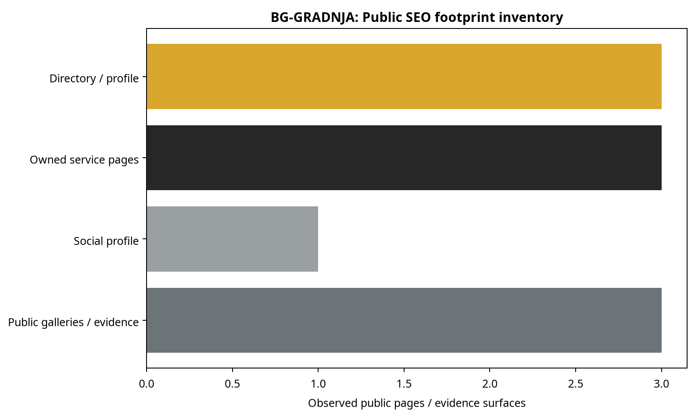
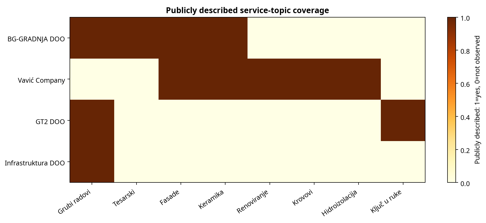
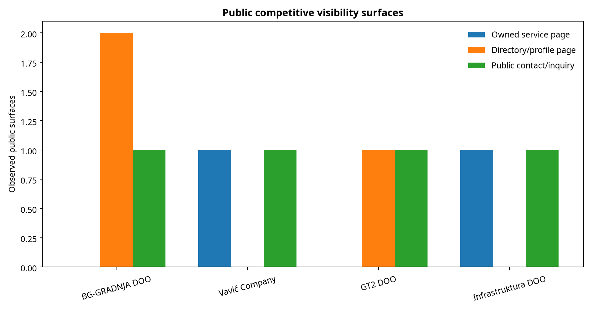

# SEO Competitor Report: BG-GRADNJA DOO (javni profil)

**Prepared by:** Manus AI  
**Date:** November 8, 2026  
**Target:** [BG-GRADNJA DOO javni profil](https://www.moja-djelatnost.me/grubi-gradevinski-radovi-herceg-novi/bg-gradnja-doo/MM1BON9h)  
**Primary data sources:** javni crawl Moja Djelatnost profila, javni CompanyWall profil, javni Instagram profil, javne stranice Vavić Company, GT2 DOO i Infrastruktura DOO, te izvedene normalizovane tabele.[1] [2] [3] [4] [5] [6]

> **Data note:** Ovo nije Ahrefs, Semrush, Similarweb ili GSC izvještaj. Javni crawl može potvrditi sadržaj, indeksirane URL-ove, lokalne signale i vidljive kontakt površine, ali ne može potvrditi organski saobraćaj, pozicije, klikove, referring domene ili backlink rast.

## Executive Narrative

**BG-GRADNJA DOO ima jasnu lokalnu prisutnost, ali je javno vidljivi SEO footprint koncentrisan na jedan directory profil, jedan business listing i Instagram.** Profil pokriva Herceg Novi, adresu, telefon, radno vrijeme, četiri usluge, galeriju, javne recenzije i formu za upit; CompanyWall potvrđuje aktivnu firmu osnovanu 20.05.2025, a Instagram dodaje javni telefon, email i objave radova.[1] [2] [3] Crawl ne sadrži podatke koji bi potvrdili organski saobraćaj, rast ili pad rangiranja.

**Najbliži javno vidljivi konkurentski modeli su lokalni servisni sajt Vavić Company i GT2-ov directory profil za izgradnju ključ u ruke.** Vavić ima vlastiti domen, odvojenu stranicu usluga, About i Contact navigaciju, višejezične varijante i veliku galeriju; GT2 koristi dugu lokalnu landing stranicu sa opisom kompletnog procesa i galerijom.[4] [5] BG-GRADNJA je sadržajno preciznija u četiri osnovne usluge i ima snažan rating signal, ali se javna organska konkurentnost ne može izmjeriti bez SEO alata.

---

# Part 1: Organic Search Performance

## 1. Business Context and Current SEO Strategy

**Javno vidljiva strategija BG-GRADNJA je local-directory plus social-proof strategija, a ne potvrđena owned-site SEO strategija.** Moja Djelatnost profil nosi glavnu kombinaciju lokalne fraze, kategorije, usluga, telefona, radnog vremena, recenzija i galerije.[1] CompanyWall služi kao poslovni entitet signal, dok Instagram služi kao vizuelni i kontaktni kanal.[2] [3]

Profilni sadržaj cilja konkretne lokalne upite: “grubi građevinski radovi Herceg Novi”, “tesarski radovi”, “zidarski radovi”, “fasade” i “keramika”. U crawl-u nijesu pronađeni zasebni owned-site URL-ovi za svaku od tih usluga; usluge su objedinjene u jednom directory profilu.[1]

## 2. Page Type Analysis: Where Organic Demand Lands

**Javni sadržaj je koncentrisan na lokalni profil, dok competitor-owned sajtovi imaju više URL površina za razdvajanje namjera.** U target crawl-u pronađena su tri glavna javna identitetska kanala: directory profil, CompanyWall business listing i Instagram profil.[1] [2] [3]

| Page type | Observed evidence | Competitive reading |
| --- | --- | --- |
| Local directory profile | Jedan detaljan profil sa naslovom, opisom, uslugama, galerijom, recenzijama i formom | Najjača postojeća lokalna SEO površina BG-GRADNJA; zavisi od platforme Moja Djelatnost.[1] |
| Business listing | CompanyWall profil sa adresom, statusom, djelatnošću, telefonom i finansijskim sažetkom | Potvrđuje entitet i poslovne podatke, ali nije content-led servisna stranica.[2] |
| Social profile | Instagram bio sa telefonom/emailom i javne objave/reels | Daje vizuelni dokaz i discovery signal, ali ne pruža crawlable servisnu arhitekturu.[3] |
| Owned service pages | Nije pronađen javno potvrđen zvanični domen BG-GRADNJA sa odvojenim service URL-ovima | Dostupni crawl ne može potvrditi širinu organic landing-page mreže.[1] |

BG-GRADNJA ima četiri jasno navedene usluge. Vavić Company javno navodi mnogo širi katalog završnih i pratećih radova, dok GT2 javno pozicionira “ključ u ruke” izgradnju od projektovanja do završnog čišćenja.[4] [5] To su različiti page-intent modeli: BG-GRADNJA je usko fokusirana, Vavić je širok finishing/maintenance katalog, a GT2 je turnkey model.

## 3. Organic Visibility by Country

**Crawl potvrđuje jedan lokalni market: Herceg Novi / Igalo i Crna Gora.** BG-GRADNJA profil navodi Svetozara Živojinovića bb, 85340 Herceg Novi, dok CompanyWall precizira Igalo u adresi.[1] [2] Instagram bio dodatno koristi lokalni identitet kroz javni profil firme i kontakt.[3]

Nema javno dostupnog country-level traffic ili keyword exporta. Zbog toga nije moguće tvrditi koliki udio organske vidljivosti dolazi iz Herceg Novog, ostatka Crne Gore ili drugih tržišta. Vavić javno navodi Herceg Novi, ali i transportne usluge u zemlji i inostranstvu; Infrastruktura je javno vezana za Podgoricu.[4] [6]

## 4. Traffic Trend: Is Organic Search Growing or Declining?

**Javni crawl ne sadrži vremensku seriju organskog saobraćaja, klikova, pozicija ili broja ranking keyworda.** Ne postoji osnova za zaključak da BG-GRADNJA raste ili opada u organic searchu. Instagram prikazuje javne objave datirane od februara do marta 2026, ali to nije saobraćaj sa pretraživača.[3]

Zbog toga nisu generisani global organic trend, country trend, page loss ili keyword loss grafikoni. Takve metrike bi zahtijevale Ahrefs, Semrush, Similarweb ili GSC podatke.

## 5. Branded vs Non-Branded Search

**Javni crawl potvrđuje prisustvo brand termina, ali ne može izračunati branded/non-branded keyword ili click share.** Brand termini uključuju “BG-GRADNJA DOO”, “BG Gradnja” i “bg.gradnja”; non-brand servisni termini uključuju “grubi građevinski radovi”, “tesarski radovi”, “fasade” i “keramika”.[1] [3]

Ovo pokazuje namjeru sadržaja, ne ranking performans. Nije moguće reći da li branded ili non-branded upiti donose više klikova. Nije moguće potvrditi ni pozicije za lokalne kombinacije sa “Herceg Novi”.

---

# Part 2: Backlink Strategy Evidence

## 6. Backlinks: How Is BG-GRADNJA Building Links?

**Backlink strategija se ne može potvrditi iz javnog crawl-a.** Crawl je pronašao javne profile i linkove između javnih kanala, ali nije pronašao referring-domain export, live backlink listu, anchor mix ili historical link data.[1] [2] [3]

Observable pattern je platform-led presence: Moja Djelatnost nosi profil, CompanyWall poslovni entitet, a Instagram vizuelne objave i kontakt.[1] [2] [3] To nije isto što i potvrđen editorial, digital-PR ili SEO link-building program. Backlink destination mix, anchor distribution i kvalitet domena ostaju nepoznati.

---

# Part 3: Strategic Assessment

## 7. Competitor Benchmarking

**U javno vidljivoj arhitekturi, Vavić Company ima najširi owned-site footprint, GT2 najjači turnkey positioning, a BG-GRADNJA najjasniji lokalni fokus na četiri usluge.** Vavić ima vlastiti domen, About, Service, Contact, višejezične linkove i veliku galeriju radova.[4] GT2 ima lokalni directory profil sa dugim opisom ključ-u-ruke procesa, galerijom, radnim vremenom i formom.[5] BG-GRADNJA ima jedan detaljan profil, CompanyWall listing, Instagram profil, ocjenu 5/5 iz 4 utiska i galeriju.[1] [2] [3]

| Entity | Public service surfaces | Local signal | Gallery / proof | Inquiry surface | What crawl can confirm |
| --- | ---: | --- | --- | --- | --- |
| BG-GRADNJA DOO | 1 main directory profile | Herceg Novi / Igalo | 4+ directory photos + Instagram posts | Moja Djelatnost form | Precizan lokalni service profile |
| Vavić Company | Owned service + About + Contact | Herceg Novi | Large owned gallery | Contact navigation | Broader owned-site architecture |
| GT2 DOO | 1 directory profile | Herceg Novi | 4+ directory photos | Moja Djelatnost form | Turnkey construction positioning |
| Infrastruktura DOO | Owned service page | Podgorica | Not central in fetched page | Contact form | Dedicated grubi-radovi page |

Nijedan od ovih javnih crawl rezultata ne daje pouzdanu rang-listu po organskom saobraćaju. Poređenje zato govori o sadržajnim površinama i lokalnim signalima, ne o market share-u.

## 8. Competitor Backlink Comparison: Link Gaps & Opportunities

**Backlink gap između BG-GRADNJA i konkurenata nije izračunljiv iz javnih stranica.** Za Vavić, GT2 i Infrastrukturu pronađeni su javni URL-ovi, ali ne i potpuni referring-domain skupovi koji bi omogućili link intersect ili brojanje high-authority missing domains.[4] [5] [6]

Javno vidljiva razlika je u owned-site link površini: Vavić povezuje Home, About, Service i Contact na vlastitom domenu, dok je BG-GRADNJA u dostupnom crawl-u predstavljena prvenstveno kroz third-party directory i social kanale.[1] [3] [4] GT2 je sličniji BG-GRADNJA modelu jer takođe koristi detaljan directory profil.[5]

Ovaj nalaz nije backlink gap. On je samo razlika u javno dostupnoj web arhitekturi. Bez Ahrefs/Semrush/DataForSEO podataka nije moguće imenovati domene koji linkuju konkurentima, a ne linkuju BG-GRADNJA.

## 9. Key Dependencies and Vulnerabilities

**Najveća vidljiva zavisnost je koncentracija lokalnog sadržaja na platformama trećih strana.** Glavni servisni opis, galerija, recenzije i upit forma nalaze se na Moja Djelatnost profilu.[1] CompanyWall i Instagram dopunjuju entity i social signale, ali nijedan javno potvrđen owned-site crawl nije pronađen.[2] [3]

**Druga zavisnost je dokazna struktura.** BG-GRADNJA ima četiri javne recenzije sa ocjenom 5 i javnu galeriju, dok konkurentski Vavić ima veliku galeriju na vlastitom domenu, a GT2 detaljan turnkey narativ sa galerijom.[1] [4] [5] Crawl ne može potvrditi da li se ta razlika prevodi u ranking ili klikove.

**Treća nepoznanica su backlinki i organski trend.** Ne postoji dokaz da je target aktivno gradio linkove, niti da je izgubio ili dobio organic visibility u posmatranom periodu. Te tvrdnje ostaju izvan dosega javnog crawl-a.

---

## References

[1]: https://www.moja-djelatnost.me/grubi-gradevinski-radovi-herceg-novi/bg-gradnja-doo/MM1BON9h "BG-GRADNJA DOO public profile, services, reviews, gallery and contact"
[2]: https://www.companywall.me/firma/bg-gradnja-doo/MMEgoXsY "BG-GRADNJA DOO CompanyWall business profile"
[3]: https://www.instagram.com/bg.gradnja/ "BG Gradnja public Instagram profile"
[4]: https://www.vaviccompany.me/index.php/me/gradjevinske-usluge-zavrsni-radovi-herceg-novi "Vavić Company public construction services page"
[5]: https://www.moja-djelatnost.me/izgradnja-objekata-kljuc-u-ruke-herceg-novi/gt-2-doo/MM1H4ipL "GT2 DOO public turnkey construction profile"
[6]: https://infrastruktura.co.me/grubi-gradevinski-radovi/ "Infrastruktura public rough construction service page"
[7]: tables/public_page_inventory.csv "Normalized public crawl page inventory"
[8]: tables/service_coverage.csv "Normalized public service-topic coverage"
[9]: charts/asset_manifest.md "Chart manifest and public-crawl data limitations"

## Methodology and Data Limits

The crawl captured publicly readable HTML and search-indexed pages on November 8, 2026. Page types and service topics were classified from visible headings, copy, navigation, links and public contact elements. The classifications are rules-based and are not ground truth for rankings, traffic or backlink ownership. No competitor API data was pulled. The competitor sections are therefore public-visibility comparisons, not quantitative backlink comparisons.

Unavailable datasets: global organic traffic trend, country traffic, country history, ranking keywords, branded/non-branded clicks, page losses, live backlinks, referring domains, anchor text distribution, backlink destination distribution and 3-month link growth/loss.

## Deliverables

- This report: `final_report.md`
- Normalized crawl table: `tables/public_page_inventory.csv`
- Normalized service comparison: `tables/service_coverage.csv`
- Charts: `charts/public_footprint_inventory.png`, `charts/service_topic_overlap.png`, `charts/competitive_visibility_surfaces.png`
- Chart manifest: `charts/asset_manifest.md`
